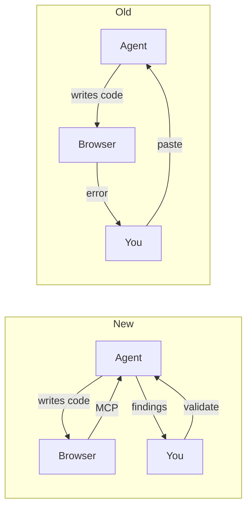
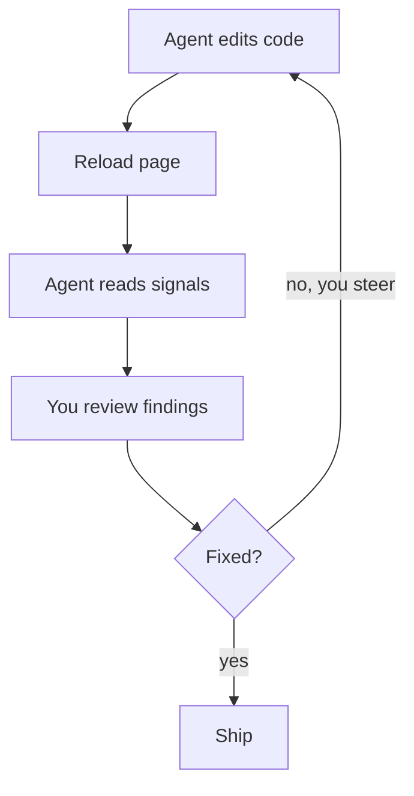
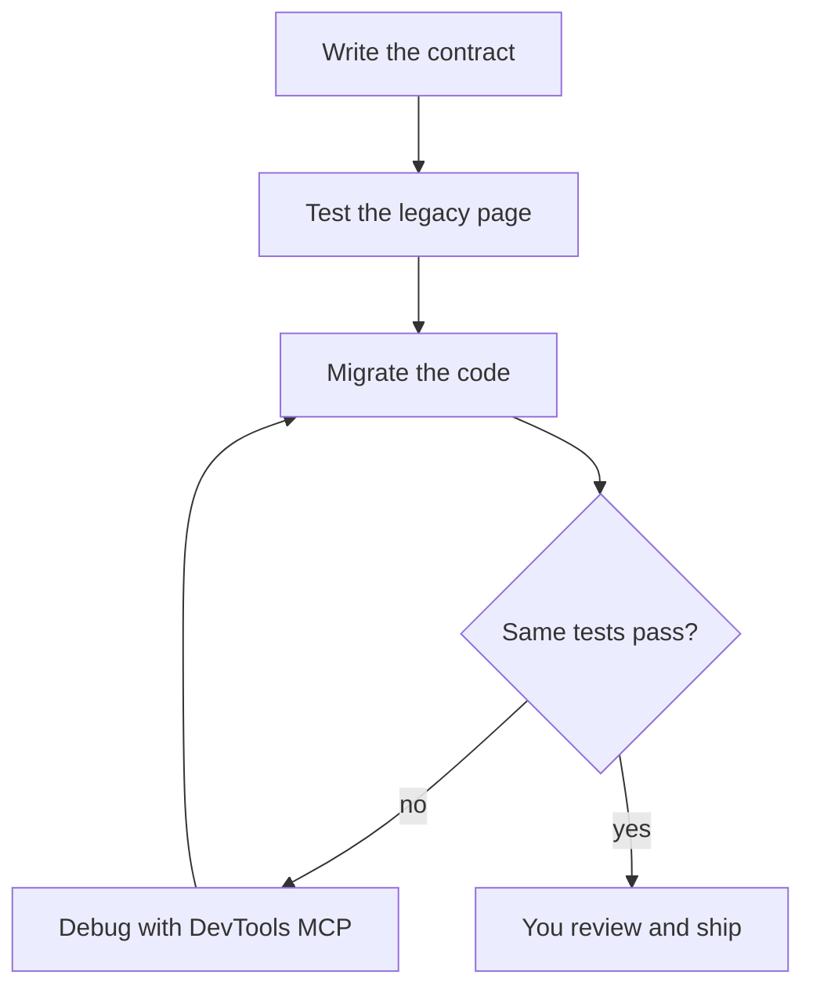
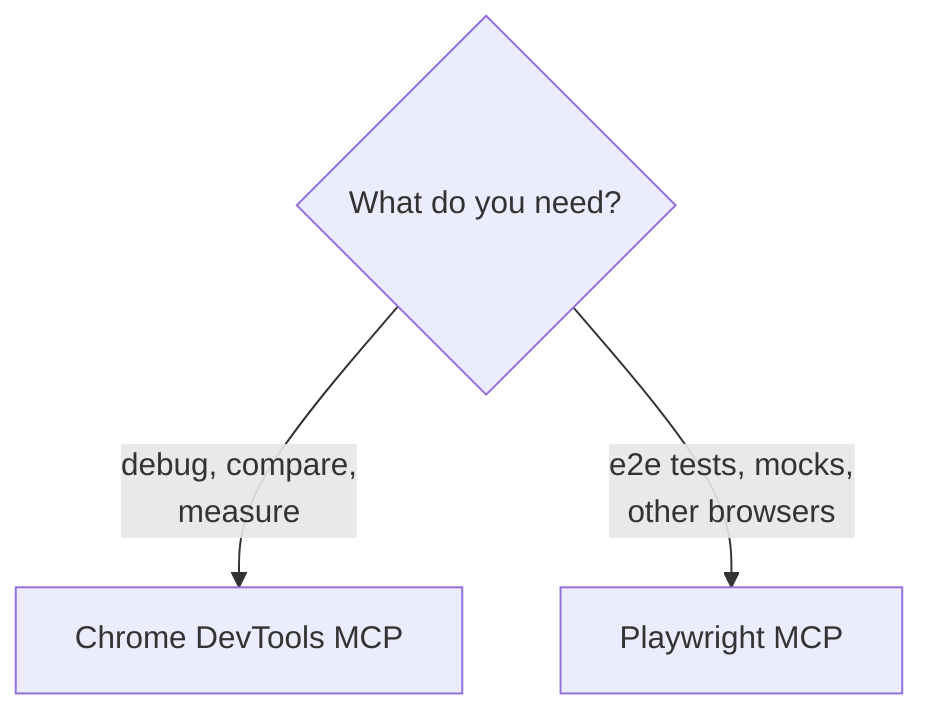

Coding agents write frontend code fast, but they can't see it run. Take a signup form that fails on submit.

<!-- TODO: swap the signup example for a real bug from your own work. -->

## The Old Way

1. The agent changes the form.
2. You open the page, click submit, and nothing happens.
3. You open DevTools, find a 422 in the Network tab, and copy the response.
4. You paste it into the chat. The agent guesses a fix.
5. You reload. Now the console shows a `TypeError`. You copy and paste again.

You're the agent's eyes, and most of your time goes to copying, not thinking.

## The New Way

1. You ask: "Submit the signup form on localhost:3000 and tell me why it fails."
2. The agent clicks submit, reads the 422 response and the console, and matches them to the code.
3. It explains the cause and proposes a fix.
4. You check that explanation against what you see in the browser, then approve or push back.



The copy-paste is gone. You're still there, in a different role.

This is human in the loop (HITL): the agent gathers evidence, and you validate it. Don't trust it 100%. It can misread a trace, or silence an error instead of fixing it. The HITL notes in this post mark where to look yourself.

## What Chrome DevTools MCP Gives the Agent

[Chrome DevTools MCP](https://github.com/ChromeDevTools/chrome-devtools-mcp) is Google's MCP server for Chrome. It lets an agent open pages, click, and read the same data you see in DevTools:

- **Console**: errors, warnings, and logs
- **Network**: requests, status codes, and payloads
- **Performance**: traces with Core Web Vitals like LCP and CLS
- **Emulation**: slow networks, offline mode, CPU throttling, dark mode, and reduced motion

[MCP](https://modelcontextprotocol.io) is an open standard, so this isn't a Claude Code feature. The same server works in Cursor, VS Code with Copilot, Codex, and Gemini CLI.

## Installing It

Most agents read the same config:

```json
{
  "mcpServers": {
    "chrome-devtools": {
      "command": "npx",
      "args": ["chrome-devtools-mcp@latest"]
    }
  }
}
```

In Claude Code, one command adds it:

```bash
claude mcp add chrome-devtools -- npx chrome-devtools-mcp@latest
```

Run `/mcp` to confirm it's connected. Then ask the agent to open your local app and list the console messages.

<!-- TODO: verify the commands against the README. Add where the config file lives in Cursor and VS Code, and the option to attach to a Chrome you already have open. -->

## The Debug Loop

With browser access, every fix follows the same loop. The agent changes the code, reloads the page, and reads the signals. You review what it found and steer it when it chases the wrong cause.



> **HITL:** Keep the browser window visible while the agent works. When it says the bug is fixed, reproduce it yourself before you believe it.

The next two sections show the loop with each signal.

### Console Errors

<!-- TODO: a real story. The error, the prompt you used, what the agent found, and where you had to step in. -->

> **HITL:** An error that disappears isn't always fixed. Check the diff: the agent may have wrapped it in a `try/catch` or removed the code that logged it.

### Network Requests

<!-- TODO: a real story. A failed request, CORS error, or wrong payload the agent matched against the code. -->

> **HITL:** Check the request against the API contract, not the agent's reading of it. Changing the frontend to accept a broken response hides a backend bug.

## Improving Core Web Vitals

Performance work is where browser access helps most. Without it, the agent guesses from the code. With it, the agent records a trace, sees which element is the LCP and what shifts the layout, and measures again after each change.

That turns "this might be faster" into numbers. The agent proposes a change, reruns the trace, and keeps it only if LCP or CLS improves.

> **HITL:** Read the trace yourself before accepting a change. One run is noise, so ask for several. And the trade-offs are yours: preloading an image or inlining CSS can win a metric and cost something else.

<!-- TODO: a real story. The trace, what the agent found, the fix, and before/after numbers. -->

## Testing How Errors Feel to Customers

Customers rarely see a crash. They see a failure handled badly: a spinner that never stops, a blank page, a form that loses what they typed. The agent can break things on purpose and show you what they see.

Each server breaks things differently:

- **Playwright MCP** mocks one request. Its `browser_route` tool makes an endpoint return a 500, a 404, or a malformed body. Start it with `npx @playwright/mcp@latest --caps=network` to enable it.
- **Chrome DevTools MCP** degrades the whole page. Its `emulate` tool sets Slow 3G, offline mode, or CPU throttling. It can't block or mock a single request.

A prompt that combines both: "Make `POST /api/signup` return a 500, submit the form, and screenshot what the user sees. Then try it on Slow 3G."

For each error state, check what the customer gets:

- A message in plain words that says what to do next, not a stack trace or raw JSON
- Their input still in the form
- A retry that works
- A loading state that ends
- Focus moved to the error, and the error announced to screen readers

Once an error state looks right, lock it in with Playwright's `page.route()` so it stays that way:

```ts
test('signup keeps the input and offers a retry when the API fails', async ({ page }) => {
  await page.route('**/api/signup', (route) => route.fulfill({ status: 500 }));
  await page.goto('/signup');
  await page.getByLabel('Email').fill('ada@example.com');
  await page.getByRole('button', { name: 'Sign up' }).click();

  await expect(page.getByRole('alert')).toContainText('Try again');
  await expect(page.getByLabel('Email')).toHaveValue('ada@example.com');
});
```

> **HITL:** The agent can confirm an error message appears. Only you can judge whether it helps. Read each error state as a customer would: is it clear, kind, and does it say what to do next?

<!-- TODO: a real error state you improved this way, with before/after screenshots. -->

## Migrating Legacy Code Without Regressions

The worst migration bug is a new page that looks almost like the old one. To catch it, capture how the legacy page behaves before you change anything.

### Start with a Contract

Write down what must stay the same. This is the contract, and every test after it checks against it.

```markdown
## Contract: /checkout

- Same visible text and layout at 390px and 1280px
- Same API requests, in the same order, with the same payloads
- No new console errors or warnings
- LCP and CLS no worse than the legacy page
- Every action reachable with the keyboard
```

The idea is the same as in [MigFlow](/posts/migflow-contracts-for-ai-migrations): agents need a contract, not a tutorial.

> **HITL:** You write or approve the contract. The agent can draft it from the legacy page, but it can't know which behavior your users depend on.

### Cover the Legacy Page with Tests

Many legacy projects have no end-to-end tests. With [Playwright MCP](https://github.com/microsoft/playwright-mcp), the agent walks through the legacy page in a real browser and writes a Playwright test for each line of the contract.

Run them against the legacy page first. They must pass there, so they describe what the page does today, quirks included.

> **HITL:** Read every test. A test that passes no matter what protects nothing. Some quirks it captures are bugs you'll want to fix, not keep.

Playwright's `toHaveScreenshot()` saves screenshots of the legacy page as the baseline. Visual changes then show up as a pixel diff, not a judgment call.

<!-- TODO: a short example test from one contract line, e.g. the API requests or the screenshot check. -->

### Migrate and Rerun the Same Tests

Now migrate, and run the same tests against the new page. A failing test is a regression. When one fails, the agent uses Chrome DevTools MCP to compare both pages and find out why.



> **HITL:** When a test fails, you decide whether the page or the test is wrong. Don't let the agent update a screenshot baseline or loosen an assertion to go green without your OK.

The tests stay in CI after the migration, so the next change is covered too.

<!-- TODO: a real migration from your work. What did the tests catch? -->

## Chrome DevTools MCP or Playwright MCP?

Use both, for different jobs. Chrome DevTools MCP is for looking inside one page: debugging, comparing, and measuring. Playwright MCP is for mocking failed requests and writing tests you can rerun, including in Firefox and Safari.



## You're Still the Engineer

These tools collect evidence. They don't decide what it means.

Every HITL note above comes down to the same habit: keep your eyes on the browser, and treat the agent's conclusions as claims to check, not facts.

The agent gets eyes on the browser. You keep the judgment.

## Limits

- The agent can be confidently wrong. It will explain a wrong cause as clearly as a right one.
- It's slower than reading the code when the bug is obvious.
- Traces and logs fill the context window, so ask for the specific signal you need.
- The agent can read cookies and local storage. Use a separate Chrome profile, not the one with your accounts.

<!-- TODO: anything else you've hit in practice. -->

## Try It

Start with one prompt in any agent: "Open localhost:3000, list the console errors, and explain the cause before fixing anything."

Migrating a page? Write the contract, then ask: "Write Playwright tests for this contract and run them against the legacy page." Run the same tests after the migration.

<!-- TODO: tie back to /posts/ai-writes-code-you-own-quality in one sentence. -->
