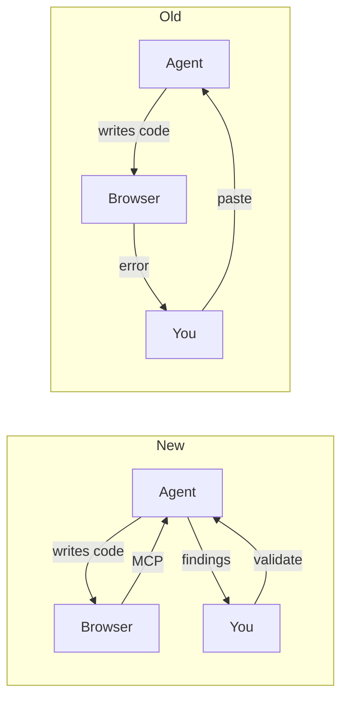
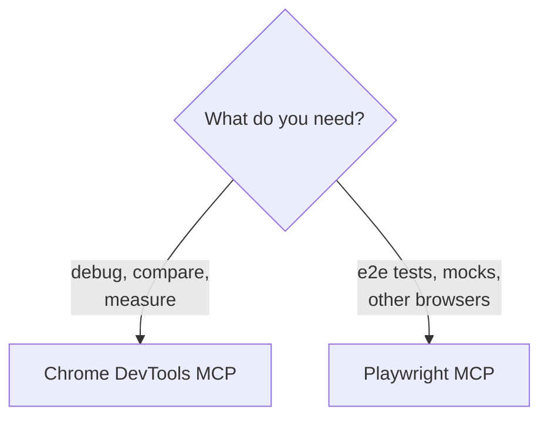
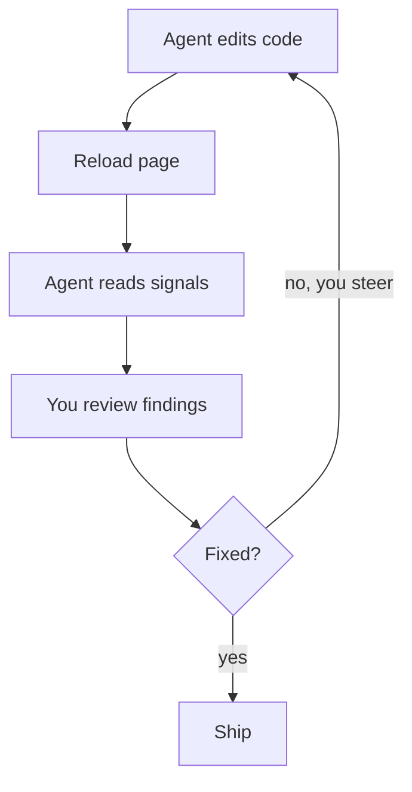
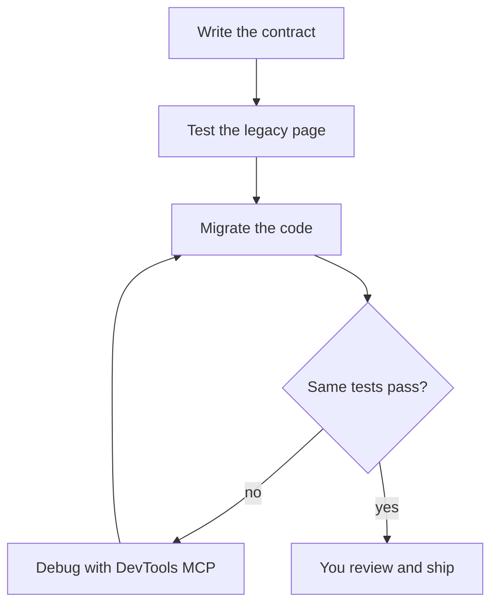

Coding agents write frontend code fast, but they can't see it run. This is the flow I use to fix that, with a signup form that fails on submit as the example.

## The Old Way

1. The agent changes the form.
2. You open the page, click submit, and nothing happens.
3. You open DevTools, find a 422 in the Network tab, and copy the response.
4. You paste it into the chat. The agent guesses a fix.
5. You reload. Now the console shows a `TypeError`. You copy and paste again.

You're the agent's eyes, and most of your time goes to copying, not thinking.

## The New Way

1. You ask: "Submit the signup form on localhost:3000 and tell me why it fails."
2. The agent clicks submit, reads the 422 response and the console, and matches them to the code.
3. It explains the cause and proposes a fix.
4. You check that explanation against what you see in the browser, then approve or push back.



The copy-paste is gone. You're still there, in a different role.

This is human in the loop (HITL): the agent gathers evidence, and you validate it. Don't trust it 100%. It can misread a trace, or silence an error instead of fixing it.

The HITL notes in this post mark where to look yourself.

## Cover Every Scenario

Browser access lets the agent put a page through every scenario your customers hit, not only the one where everything works:

| Scenario                                    | What the customer should get               |
| ------------------------------------------- | ------------------------------------------ |
| [Success](#the-debug-loop)                  | The flow works end to end                  |
| [Slow](#testing-slow-and-failing-requests)  | A loading state, no double submits         |
| [Error](#testing-slow-and-failing-requests) | A clear message, their input kept, a retry |
| [Performance](#improving-core-web-vitals)   | Fast loading, no layout shifts             |
| [Accessibility](#checking-accessibility)    | Works with a keyboard and a screen reader  |

The rest of this post shows how to set it up, then walks through each one.

## The Tools

Two MCP servers give an agent a browser. [MCP](https://modelcontextprotocol.io) is an open standard, so neither is tied to Claude Code. Both work in Cursor, VS Code with Copilot, Codex, and Gemini CLI.

### Chrome DevTools MCP

[Chrome DevTools MCP](https://github.com/ChromeDevTools/chrome-devtools-mcp) is Google's MCP server for Chrome. It lets the agent open pages, click, and read what you see in DevTools:

- **Console**: errors, warnings, and logs
- **Network**: requests, status codes, and payloads
- **Performance**: traces with Core Web Vitals like LCP and CLS
- **Accessibility**: Lighthouse audits and the accessibility tree
- **Emulation**: slow networks, offline mode, CPU throttling, dark mode, reduced motion, and forced colors

### Playwright MCP

[Playwright MCP](https://github.com/microsoft/playwright-mcp) is Microsoft's MCP server for browser automation. It drives Chromium, Firefox, and WebKit, can make a single request fail, and helps the agent write end-to-end tests you can rerun.

### Installing Them

Most agents read the same config:

```json
{
  "mcpServers": {
    "chrome-devtools": {
      "command": "npx",
      "args": ["-y", "chrome-devtools-mcp@latest"]
    },
    "playwright": {
      "command": "npx",
      "args": ["@playwright/mcp@latest", "--caps=network"]
    }
  }
}
```

The `--caps=network` flag turns on Playwright MCP's request mocking. In Cursor, add the config under Settings > MCP. In VS Code, both READMEs have one-click install buttons.

In Claude Code, two commands add both:

```bash
claude mcp add chrome-devtools --scope user npx chrome-devtools-mcp@latest
claude mcp add playwright -- npx @playwright/mcp@latest --caps=network
```

Run `/mcp` to confirm they're connected. Then ask the agent to open your local app and list the console messages.

By default, Chrome DevTools MCP starts its own Chrome. To use the one you already have open, add `--autoConnect`. It needs Chrome 144 or later, with remote debugging allowed at `chrome://inspect/#remote-debugging`.

### Which One When

Use both, for different jobs. Chrome DevTools MCP looks inside one page: debugging, comparing, and measuring. Playwright MCP fails requests on purpose and writes tests you can rerun in any browser.



## The Debug Loop

Start with the success path: the flow working end to end. With browser access, getting there follows the same loop every time.

The agent changes the code, reloads the page, and reads the signals. You review what it found and steer it when it chases the wrong cause.



> **HITL:** Keep the browser window visible while the agent works. When it says the bug is fixed, reproduce it yourself before you believe it.

The two signals you'll read most are console errors and network requests.

### Console Errors

My prompt: "Open /signup, submit the form, and list the console errors. Explain the cause before changing anything."

The agent reads the error and its stack trace, opens the file it points to, and tells you what it thinks went wrong. You read that explanation before any code changes.

> **HITL:** An error that disappears isn't always fixed. Check the diff: the agent may have wrapped it in a `try/catch` or removed the code that logged it.

### Network Requests

My prompt: "Submit the form and show me the request and response for `/api/signup`. Compare the payload with what the backend expects."

The agent lists the requests, opens the failing one, and compares its body with the code that builds it. A misnamed field or a missing header shows up right there.

> **HITL:** Check the request against the API spec, not the agent's reading of it. Changing the frontend to accept a broken response hides a backend bug.

## Testing Slow and Failing Requests

Customers rarely see a crash. They see a failure handled badly: a spinner that never stops, a blank page, a form that loses what they typed. The agent can slow things down or break them on purpose and show you what customers see.

Each server does this differently:

- **Playwright MCP** fails one request: `browser_route` makes an endpoint return a 500, a 404, or a malformed body.
- **Chrome DevTools MCP** degrades the whole page: `emulate` sets Slow 3G, offline mode, or CPU throttling. It can't mock a single request.

My prompt, combining both: "Make `POST /api/signup` return a 500, submit the form, and screenshot what the user sees. Then try it on Slow 3G."

### Slow

On Slow 3G or with the CPU throttled, check what the customer gets:

- A loading state that shows up right away and ends, with an error if it takes too long
- A submit button they can't press twice
- Content that doesn't jump around when it arrives

### Error

With a request failing, check what the customer gets:

- A message in plain words that says what to do next, not a stack trace or raw JSON
- Their input still in the form
- A retry that works
- Focus moved to the error, and the error announced to screen readers

Once a state looks right, lock it in with Playwright's `page.route()` so it stays that way:

```ts
test('signup keeps the input and offers a retry when the API fails', async ({
  page,
}) => {
  await page.route('**/api/signup', (route) => route.fulfill({ status: 500 }));
  await page.goto('/signup');
  await page.getByLabel('Email').fill('ada@example.com');
  await page.getByRole('button', { name: 'Sign up' }).click();

  await expect(page.getByRole('alert')).toContainText('Try again');
  await expect(page.getByLabel('Email')).toHaveValue('ada@example.com');
});
```

> **HITL:** The agent can confirm an error message appears. Only you can judge whether it helps. Read each error state as a customer would: is it clear, kind, and does it say what to do next?

## Improving Core Web Vitals

Slow requests are one side of speed. The other is how fast the page loads and settles, and that's where browser access helps most.

Without it, the agent guesses from the code. With it, the agent records a trace, sees which element is the LCP and what shifts the layout, and measures again after each change.

My prompt: "Record a performance trace of the home page with the CPU throttled 4x. Tell me the LCP element and what shifts the layout, then suggest one change at a time."

That turns "this might be faster" into numbers. The agent proposes a change, reruns the trace, and keeps it only if LCP or CLS improves.

> **HITL:** Read the trace yourself before accepting a change. One run is noise, so ask for several. And the trade-offs are yours: preloading an image or inlining CSS can win a metric and cost something else.

## Checking Accessibility

An accessible page works for every customer: people on a keyboard, on a screen reader, or who need more contrast or less motion. The agent can check part of this in the browser.

Chrome DevTools MCP runs a Lighthouse audit and reads the accessibility tree, the names and roles a screen reader announces. It also turns on the settings some customers rely on: forced colors, higher contrast, and reduced motion.

My prompt: "Run a Lighthouse accessibility audit on /signup, then tab through the form and tell me where the focus goes."

Lock the fixes in with [axe](https://github.com/dequelabs/axe-core-npm/tree/develop/packages/playwright) in your Playwright tests:

```ts
import AxeBuilder from '@axe-core/playwright';

test('signup has no detectable accessibility violations', async ({ page }) => {
  await page.goto('/signup');
  const results = await new AxeBuilder({ page }).analyze();
  expect(results.violations).toEqual([]);
});
```

> **HITL:** Automated checks catch only some accessibility issues. A clean audit doesn't mean the page works with a screen reader. Tab through it yourself, and try VoiceOver or NVDA on the flows that matter.

## Migrating Legacy Code Without Regressions

A migration has to keep every scenario working. The worst migration bug is a new page that looks almost like the old one, so capture how the legacy page behaves before you change anything.

### Start with a Contract

Write down what must stay the same. This is the contract, and every test after it checks against it.

```markdown
## Contract: /checkout

- Same visible text and layout at 390px and 1280px
- Same API requests, in the same order, with the same payloads
- No new console errors or warnings
- LCP and CLS no worse than the legacy page
- Every action reachable with the keyboard
```

The idea is the same as in [MigFlow](/posts/migflow-contracts-for-ai-migrations): agents need a contract, not a tutorial.

> **HITL:** You write or approve the contract. The agent can draft it from the legacy page, but it can't know which behavior your users depend on.

### Cover the Legacy Page with Tests

Many legacy projects have no end-to-end tests. With Playwright MCP, the agent walks through the legacy page in a real browser and writes a Playwright test for each line of the contract.

Run them against the legacy page first. They must pass there, so they describe what the page does today, quirks included.

Playwright's `toHaveScreenshot()` saves screenshots of the legacy page as the baseline. Visual changes then show up as a pixel diff, not a judgment call:

```ts
test('checkout looks the same as the legacy page', async ({ page }) => {
  await page.goto('/checkout');
  await expect(page).toHaveScreenshot('checkout.png', { fullPage: true });
});
```

Create the baseline from the legacy page with `npx playwright test --update-snapshots`. After that, every run compares against it.

> **HITL:** Read every test. A test that passes no matter what protects nothing. Some quirks it captures are bugs you'll want to fix, not keep.

### Migrate and Rerun the Same Tests

Now migrate, and run the same tests against the new page. A failing test is a regression. When one fails, the agent uses Chrome DevTools MCP to compare both pages and find out why.

The tests stay in CI after the migration, so the next change is covered too.



> **HITL:** When a test fails, you decide whether the page or the test is wrong. Don't let the agent update a screenshot baseline or loosen an assertion to go green without your OK.

## Limits

- The agent can be confidently wrong. It will explain a wrong cause as clearly as a right one.
- It's slower than reading the code when the bug is obvious.
- Traces and logs fill the context window, so ask for the specific signal you need.
- The agent can read cookies and local storage. Add `--isolated` for a temporary profile, and be careful with `--autoConnect`, which uses the Chrome you're signed in to.
- Performance traces may send page URLs to Google's CrUX API. Add `--no-performance-crux` when you debug internal URLs.

## Try It

Start with one prompt in any agent: "Open localhost:3000, list the console errors, and explain the cause before fixing anything."

Then try the other scenarios on one page: "Load the checkout page on Slow 3G, then with the payment request failing, and screenshot what the customer sees in each case."

Migrating a page? Write the contract, then ask: "Write Playwright tests for this contract and run them against the legacy page." Run the same tests after the migration.

## A Tool in the Engineer's Hands

Success, slow, error, performance, accessibility: the agent can now put a page through every scenario and bring you the evidence. That's a powerful tool in the engineer's hands.

It doesn't decide what the evidence means. Every HITL note above comes down to the same habit: keep your eyes on the browser, and treat the agent's conclusions as claims to check, not facts.

As I wrote in [AI Writes Code. You Own Quality.](/posts/ai-writes-code-you-own-quality), speed without judgment means shipping bugs faster. Browser access doesn't change who owns the fix. It gives you better evidence to own it with.

The agent gets eyes on the browser. You keep the judgment.
