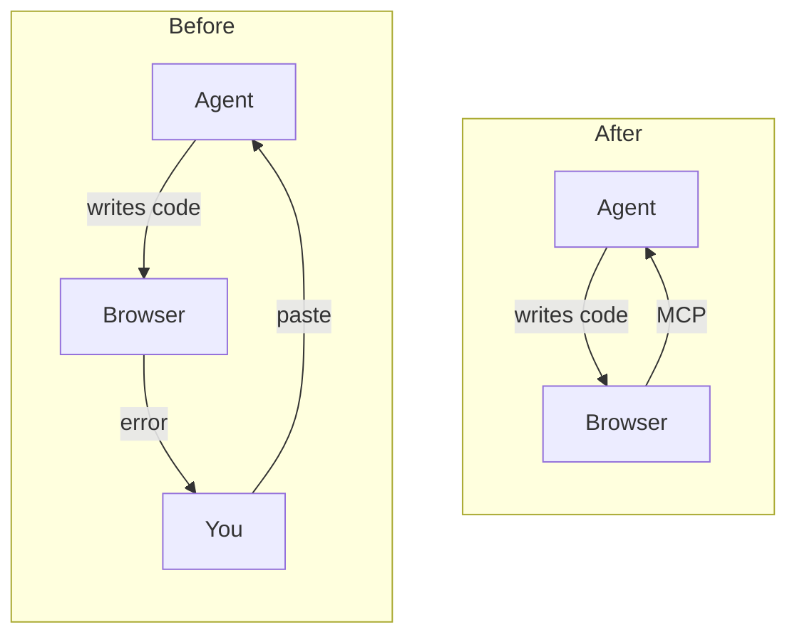
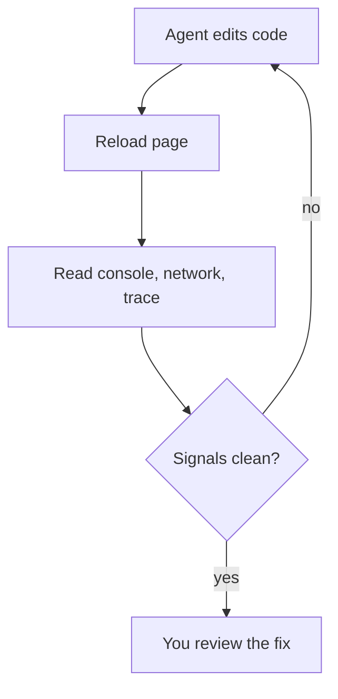
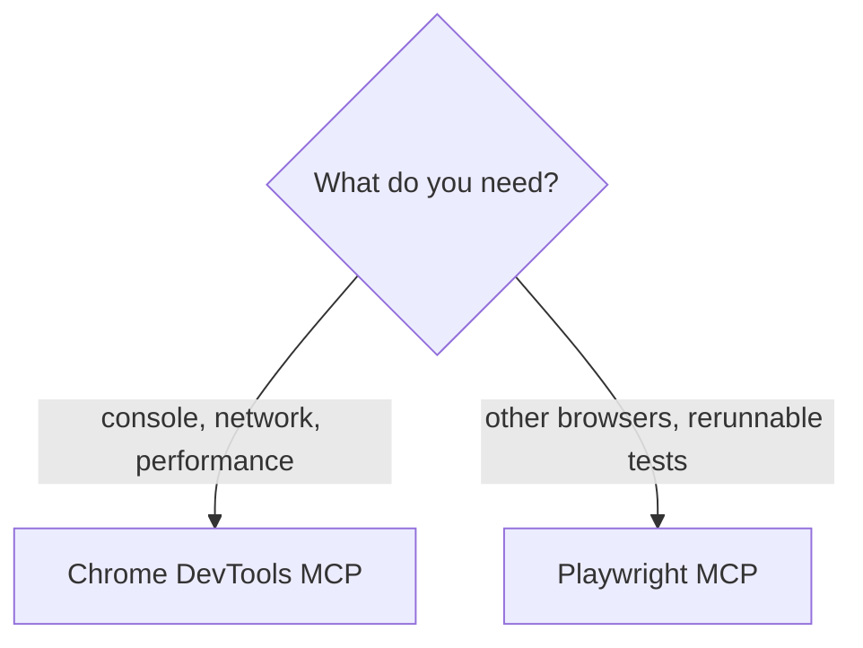

Coding agents write frontend code fast, but they can't see it run. When the page breaks, you open DevTools, copy the error, and paste it back into the chat.

You become the agent's eyes. Browser access through MCP removes that step: the agent reads the browser itself, and you review the result.



<!-- TODO: one short real example of the old copy-paste loop, from your own work. -->

## What Chrome DevTools MCP Gives the Agent

[Chrome DevTools MCP](https://github.com/ChromeDevTools/chrome-devtools-mcp) is Google's MCP server for Chrome. It lets an agent open pages, click, and read the same data you see in DevTools:

- **Console**: errors, warnings, and logs
- **Network**: requests, status codes, and payloads
- **Performance**: traces with Core Web Vitals like LCP and CLS

[MCP](https://modelcontextprotocol.io) is an open standard, so this isn't a Claude Code feature. The same server works in Cursor, VS Code with Copilot, Codex, and Gemini CLI.

## Installing It

Most agents read the same config:

```json
{
  "mcpServers": {
    "chrome-devtools": {
      "command": "npx",
      "args": ["chrome-devtools-mcp@latest"]
    }
  }
}
```

In Claude Code, one command adds it:

```bash
claude mcp add chrome-devtools -- npx chrome-devtools-mcp@latest
```

Run `/mcp` to confirm it's connected. Then ask the agent to open your local app and list the console messages.

<!-- TODO: verify the commands against the README. Add where the config file lives in Cursor and VS Code, and the option to attach to a Chrome you already have open. -->

## The Debug Loop

With browser access, every fix follows the same loop. The agent changes the code, reloads the page, and reads the signals. It repeats until they're clean, then hands the fix to you.



The next three sections show the loop with each signal.

### Console Errors

<!-- TODO: a real story. The error, the prompt you used, and what the agent found and fixed without you pasting anything. -->

### Network Requests

<!-- TODO: a real story. A failed request, CORS error, or wrong payload the agent matched against the code. -->

### Core Web Vitals

<!-- TODO: a real story. The trace, the LCP or CLS problem, the fix, and before/after numbers. -->

## Chrome DevTools MCP or Playwright MCP?

Both give agents a browser, but for different jobs. Chrome DevTools MCP is for debugging one page in depth. [Playwright MCP](https://github.com/microsoft/playwright-mcp) is for checking other browsers and writing tests you can rerun.



## Limits

- It's slower than reading the code when the bug is obvious.
- Traces and logs fill the context window, so ask for the specific signal you need.
- The agent can read cookies and local storage. Use a separate Chrome profile, not the one with your accounts.

<!-- TODO: anything else you've hit in practice. -->

## Try It

The agent no longer needs you to read the browser for it. Your job is to judge what it finds.

Start with one prompt in any agent: "Open localhost:3000, list the console errors, and fix them."

<!-- TODO: tie back to /posts/ai-writes-code-you-own-quality in one sentence. -->
