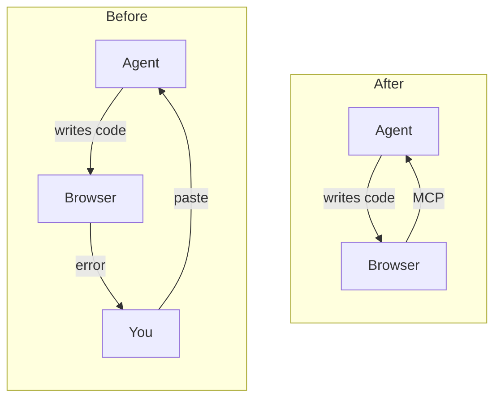
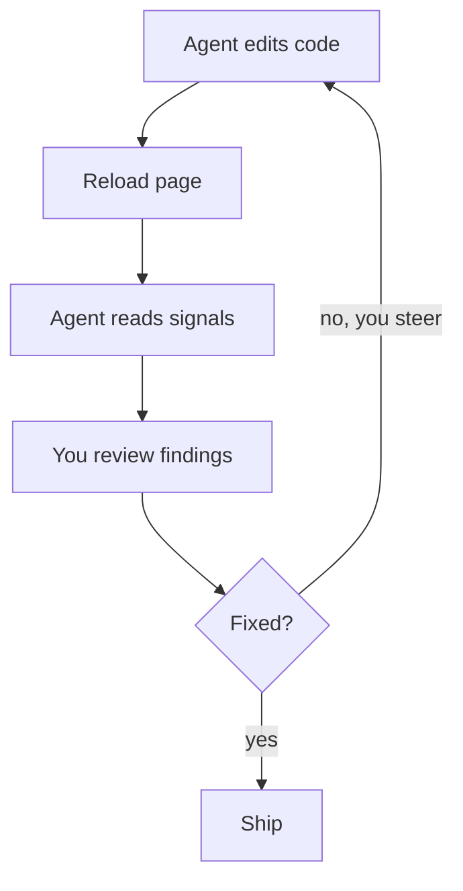
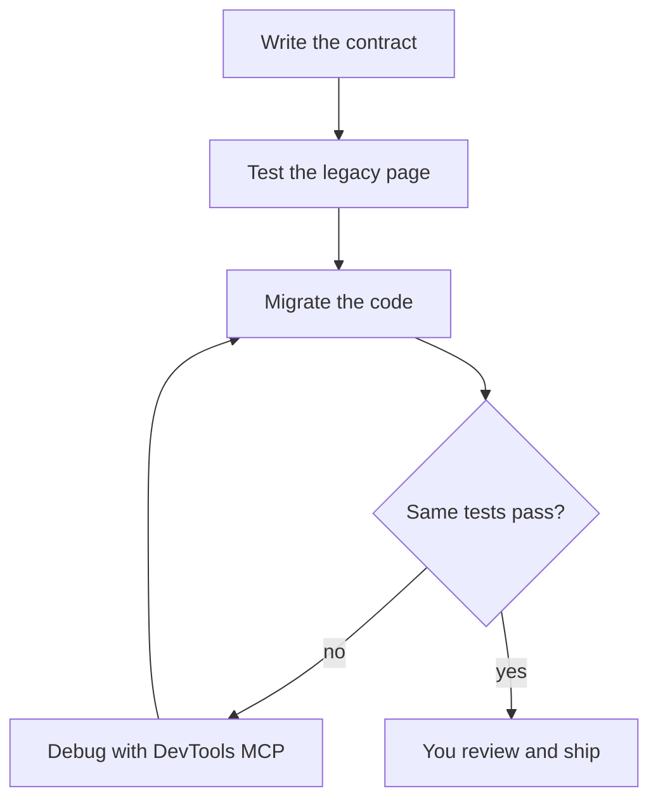
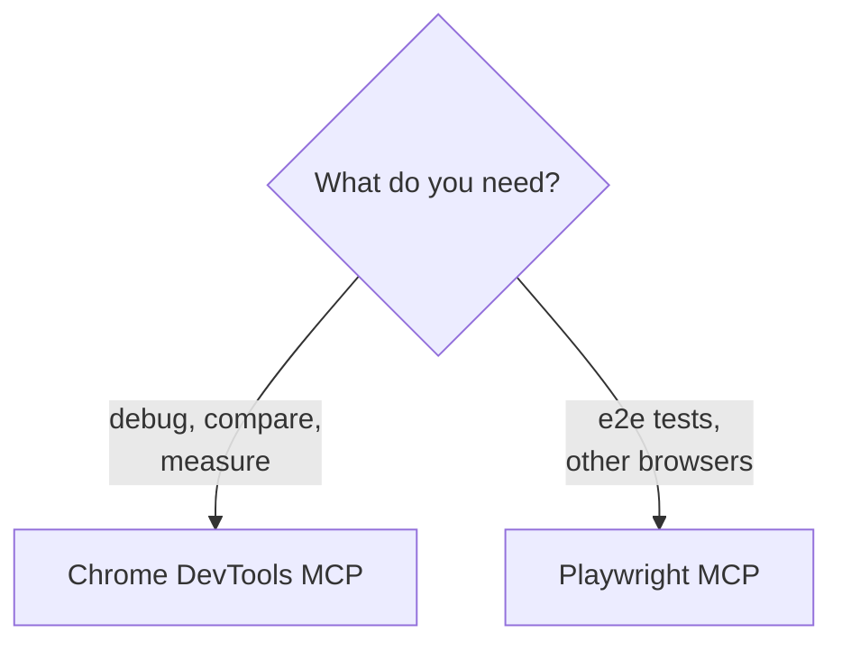

Coding agents write frontend code fast, but they can't see it run. When the page breaks, you open DevTools, copy the error, and paste it back into the chat.

You become the agent's eyes. Browser access through MCP changes that: the agent reads the browser too, so you both look at the same evidence.

This doesn't replace the engineer. It gives you more ways to debug, and you still decide what's a bug and what the right fix is.



<!-- TODO: one short real example of the old copy-paste loop, from your own work. -->

## What Chrome DevTools MCP Gives the Agent

[Chrome DevTools MCP](https://github.com/ChromeDevTools/chrome-devtools-mcp) is Google's MCP server for Chrome. It lets an agent open pages, click, and read the same data you see in DevTools:

- **Console**: errors, warnings, and logs
- **Network**: requests, status codes, and payloads
- **Performance**: traces with Core Web Vitals like LCP and CLS

[MCP](https://modelcontextprotocol.io) is an open standard, so this isn't a Claude Code feature. The same server works in Cursor, VS Code with Copilot, Codex, and Gemini CLI.

## Installing It

Most agents read the same config:

```json
{
  "mcpServers": {
    "chrome-devtools": {
      "command": "npx",
      "args": ["chrome-devtools-mcp@latest"]
    }
  }
}
```

In Claude Code, one command adds it:

```bash
claude mcp add chrome-devtools -- npx chrome-devtools-mcp@latest
```

Run `/mcp` to confirm it's connected. Then ask the agent to open your local app and list the console messages.

<!-- TODO: verify the commands against the README. Add where the config file lives in Cursor and VS Code, and the option to attach to a Chrome you already have open. -->

## The Debug Loop

With browser access, every fix follows the same loop. The agent changes the code, reloads the page, and reads the signals. You review what it found and steer it when it chases the wrong cause.



The next two sections show the loop with each signal.

### Console Errors

<!-- TODO: a real story. The error, the prompt you used, what the agent found, and where you had to step in. -->

### Network Requests

<!-- TODO: a real story. A failed request, CORS error, or wrong payload the agent matched against the code. -->

## Improving Core Web Vitals

Performance work is where browser access helps most. Without it, the agent guesses from the code. With it, the agent records a trace, sees which element is the LCP and what shifts the layout, and measures again after each change.

That turns "this might be faster" into numbers. The agent proposes a change, reruns the trace, and keeps it only if LCP or CLS improves.

You still choose the trade-offs. Preloading an image or inlining CSS can win a metric and cost something else, and that call is yours.

<!-- TODO: a real story. The trace, what the agent found, the fix, and before/after numbers. -->

## Migrating Legacy Code Without Regressions

The worst migration bug is a new page that looks almost like the old one. To catch it, capture how the legacy page behaves before you change anything.

### Start with a Contract

Write down what must stay the same. This is the contract, and every test after it checks against it.

```markdown
## Contract: /checkout

- Same visible text and layout at 390px and 1280px
- Same API requests, in the same order, with the same payloads
- No new console errors or warnings
- LCP and CLS no worse than the legacy page
- Every action reachable with the keyboard
```

The idea is the same as in [MigFlow](/posts/migflow-contracts-for-ai-migrations): agents need a contract, not a tutorial.

### Cover the Legacy Page with Tests

Many legacy projects have no end-to-end tests. With [Playwright MCP](https://github.com/microsoft/playwright-mcp), the agent walks through the legacy page in a real browser and writes a Playwright test for each line of the contract.

Run them against the legacy page first. They must pass there, so they describe what the page does today, quirks included. Review them: some quirks are bugs you'll want to fix, not keep.

Playwright's `toHaveScreenshot()` saves screenshots of the legacy page as the baseline. Visual changes then show up as a pixel diff, not a judgment call.

<!-- TODO: a short example test from one contract line, e.g. the API requests or the screenshot check. -->

### Migrate and Rerun the Same Tests

Now migrate, and run the same tests against the new page. A failing test is a regression. When one fails, the agent uses Chrome DevTools MCP to compare both pages and find out why.



The tests stay in CI after the migration, so the next change is covered too.

<!-- TODO: a real migration from your work. What did the tests catch? -->

## Chrome DevTools MCP or Playwright MCP?

Use both, for different jobs. Chrome DevTools MCP is for looking inside one page: debugging, comparing, and measuring. Playwright MCP is for tests you can rerun, including in Firefox and Safari.



## You're Still the Engineer

These tools collect evidence. They don't decide what it means.

Watch the browser while the agent works. Read the trace yourself when a number looks off. Question a fix that makes the error disappear without explaining it.

The agent gets eyes on the browser. You keep the judgment.

## Limits

- It's slower than reading the code when the bug is obvious.
- Traces and logs fill the context window, so ask for the specific signal you need.
- The agent can read cookies and local storage. Use a separate Chrome profile, not the one with your accounts.

<!-- TODO: anything else you've hit in practice. -->

## Try It

Start with one prompt in any agent: "Open localhost:3000, list the console errors, and explain the cause before fixing anything."

Migrating a page? Write the contract, then ask: "Write Playwright tests for this contract and run them against the legacy page." Run the same tests after the migration.

<!-- TODO: tie back to /posts/ai-writes-code-you-own-quality in one sentence. -->
