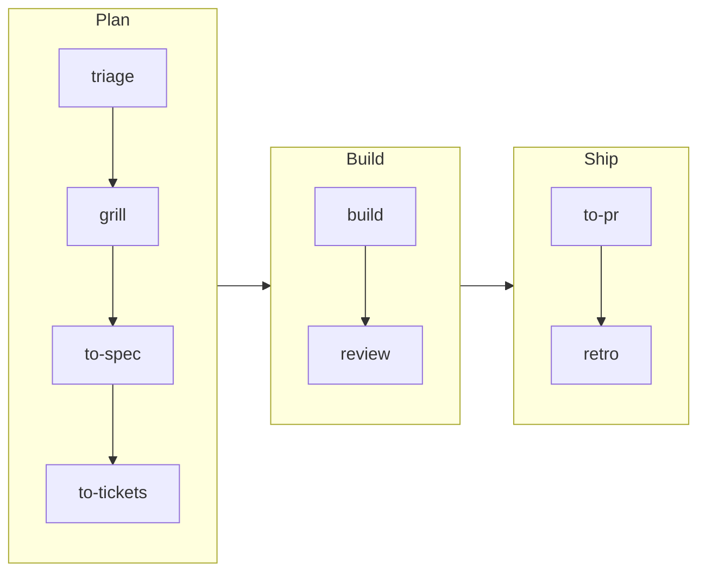
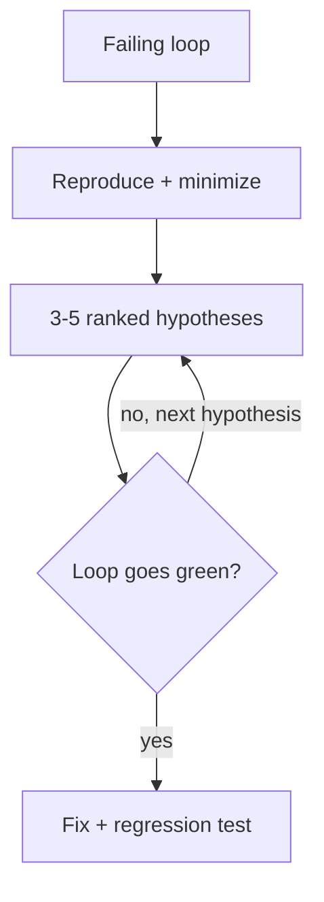

My AI coding workflow changes every few months, so I give it version numbers. New tools ship, models get better, and steps that needed hand-holding last spring now run on their own.

[v1](/posts/how-i-use-claude-code-to-build-features) was plan mode and a hand-written `SPEC.md`. [v2](/posts/why-i-built-tracerkit) turned that into TracerKit.

This post is v3, where every step lives in [helderberto/agent-skills](https://github.com/helderberto/agent-skills).

The idea of v3 fits in one line: each step that used to be a prompt is now a skill, and each "please remember to" is now a check that fails.

## Why I moved off TracerKit (v2)

TracerKit worked, but it was a separate tool with its own release cycle. Every tweak to a step meant a change there, a release, and an update in each project. I wanted a simpler way to ship updates and add new skills.

I was already keeping my other skills in agent-skills. Moving the spec flow next to them put everything in one place. Now changing a step or adding a skill is one commit.

The ideas from TracerKit survived: interviews before specs, tracer-bullet tickets, verification before a task counts as done. They live in the same repo as the rest of my skills.

## Standing on two repos

I didn't design v3 from scratch. Most of it comes from two repos, and I took what I think is the best of each.

From [Matt Pocock's skills](https://github.com/mattpocock/skills) I took the shape of the flow:

- `grill-me`, the interview that runs until a plan has no open branches
- `to-spec` and `to-tickets`, with tracer-bullet tickets and blocking links
- `diagnosing-bugs`, the phased debugging loop
- `tdd`, `prototype`, `domain-modeling`, `codebase-design` and `retro`

From [Addy Osmani's agent-skills](https://github.com/addyosmani/agent-skills) I took the engineering depth inside each step:

- `frontend-ui-engineering`, for decisions to make before writing a component
- `source-driven-development`, so code follows the docs for the installed version
- `security-and-hardening` and `performance-optimization`
- `browser-testing-with-devtools`, for checking UI in a real browser

Then I cut each one down to what changes the agent's behavior in my projects, and gave them one namespace: `/hb:`.

## The flow at a glance

A feature moves through eight commands:



Not every task needs all of them. `/hb:triage` sizes the work and names where to start. A small fix goes straight to `/hb:build`.

## Skills replace prompts

Take the same dark mode toggle from v1. Back then, I opened plan mode and wrote a paragraph asking Claude to discuss the approach and generate a spec. Now it starts with one command:

```plaintext
/hb:grill dark mode
```

The grill interviews me in rounds. Each round asks every question I can answer right now, each with a recommended answer, so a bare "yes" accepts it. Settled terms go to a glossary, and hard-to-reverse decisions become ADRs as they land.

Then the conversation becomes artifacts:

```plaintext
/hb:to-spec dark-mode
/hb:to-tickets dark-mode
```

The spec lands in `.specs/specs/dark-mode.md`. The tickets are thin vertical slices with blocking edges, so the agent knows which one is unblocked next. The v1 checklist is still there, but now it has an order.

Building is one command too:

```plaintext
/hb:build dark-mode
```

It takes the next unblocked ticket, works test-first, runs the project's checks and commits. With `--all`, it fans tickets out to parallel subagents after one approval.

I no longer write those prompts. I wrote them once, as skills, and now I refine the skills. I made the case for this in [Skills Are the New CLI](/posts/skills-are-the-new-cli).

## MCPs let the agent see the page

Type-checked is not the same as working. For frontend code, the agent needs to see what the user sees.

The `visual-review` skill, in UI mode, drives a real browser through the Chrome DevTools MCP.

It takes a screenshot before the change, performs the interactions I name, takes another screenshot, and reports console errors, failed requests and accessibility issues.

The rule I care most about: it reports console output even on a pass. Silent regressions show up there first, often while every test is still green.

The skill also knows its limits. It never starts the dev server itself, because ports and running servers are my state, not the agent's. And when a flow is worth checking on every change, it hands off to `tdd` for an end-to-end test.

## Guardrails over instructions

Instructions in a prompt get skipped under pressure. A check that fails does not. So most of my guardrails are things that exit with an error:

- **`/hb:check`** runs the project's own lint, types and tests before every commit
- **Coverage limits** fail the build, so "add tests" is never a request
- **`hitl` tickets** stop `/hb:build --all` before work that needs a human
- **`/hb:safe-repo --diff`** scans the branch for secrets before a PR goes up
- **`harden`** lists changes that need my approval first: auth, PII, CORS, file uploads

The agent can be fast because it can't quietly skip these. I wrote more about why this matters in [Code Got Cheap. Review Didn't.](/posts/code-got-cheap-review-didnt)

## When something breaks

`/hb:debug` has one rule I now follow without an agent too: no theory before a feedback loop.

Before reading code to guess a cause, the agent has to show one command that reproduces the bug. It must fail on the exact symptom, give the same result every run, and finish in seconds. A failing test, a curl, a headless browser script.



Only then does it list 3 to 5 ranked hypotheses, each with a prediction that could prove it wrong. That stops the agent from fixing the first plausible cause, which is the habit that wasted most of my debugging sessions.

The loop does most of the work. Once it exists, finding the cause is mostly bisecting and testing hypotheses against it.

## The flow improves itself

The last step is `/hb:retro`. It reads the session and suggests changes to the environment, not the code: a missing check, a rule in `AGENTS.md` that should be a lint rule, a file the agent took too long to find.

This is where moving off TracerKit pays off. A retro finding becomes a one-line edit in agent-skills, and every project picks it up on the next update.

## Wrapping up

In v1, the spec was the memory. It still is. What changed is everything around it. The prompts I kept retyping are skills, the reminders I kept giving are checks, and the browser is something the agent can look at.

This flow will change again with the next tool or model. When it does, it will be a commit to [agent-skills](https://github.com/helderberto/agent-skills), and v4.

---

**Related:**

- [How I Use Claude Code to Build Features](/posts/how-i-use-claude-code-to-build-features)
- [Why I Built TracerKit](/posts/why-i-built-tracerkit)
- [Skills Are the New CLI](/posts/skills-are-the-new-cli)
- [Code Got Cheap. Review Didn't.](/posts/code-got-cheap-review-didnt)
